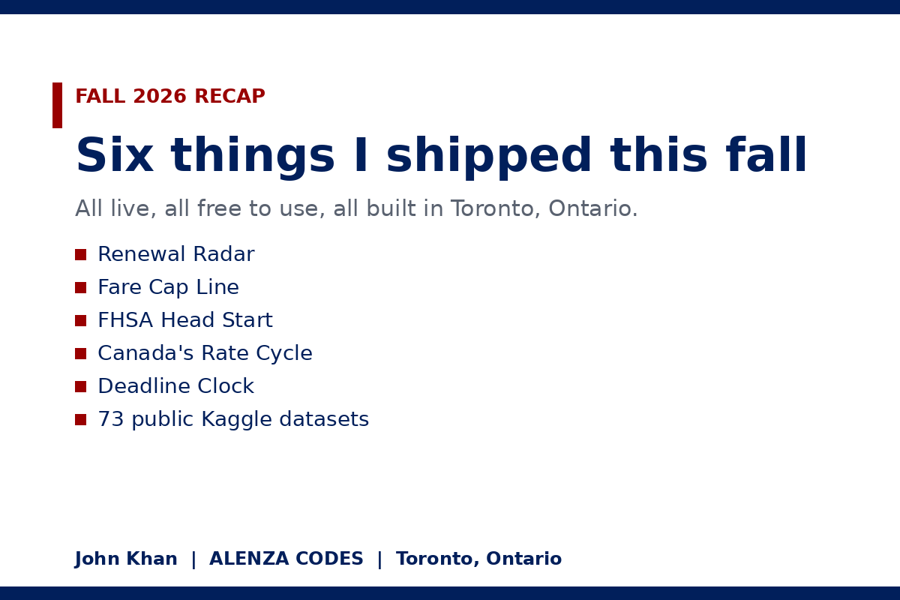

# Six Things I Shipped This Fall

A recap carousel of my fall 2026 builds, made in Gamma from screenshots of my own live projects.



Gamma view link: added after publishing

## The cards
1. Six things I shipped this fall (the card that gets people to swipe)
2. [Renewal Radar](https://renewal-radar-site.vercel.app)
3. [Fare Cap Line](https://alenzacodes.github.io/ttc-fare-cap/)
4. [FHSA Head Start](https://alenzacodes.github.io/fhsa-head-start/)
5. [Canada's Rate Cycle, 2015 to 2026](https://alenzacodes.github.io/canada-rate-cycle-dashboard/)
6. [Deadline Clock](https://alenzacodes.github.io/deadline-clock/)
7. [73 public datasets on Kaggle](https://www.kaggle.com/johnnykhan1/datasets)
8. What I learned
9. What should get a version two?

## Extensions built
1. A sharper first card
2. A card on what I learned
3. A restyle of the whole carousel in navy and deep red on white

## Project structure

```text
fall-2026-recap-carousel/
├── photos/            # Screenshots of my own live projects, taken Nov 12, 2026 (7 files)
├── card-photo-map.md  # Which photo goes on which card
├── cover.png          # Cover image
├── gamma-prompt.md    # The exact text pasted into Gamma's classic generator
├── README.md          # This file
└── sources.md         # Where every number on the cards comes from
```

Built by John Khan, ALENZA CODES, Toronto, Ontario.
